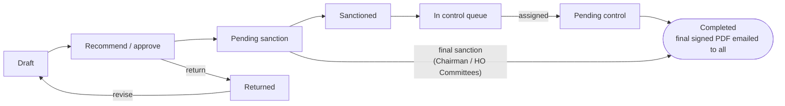

# eOffice – Functional Requirements Specification

Version 0.1 – Draft · 3 Nov 2026

## 1. Document control

This is the agreed functional baseline for eOffice, version 0.1 (draft for review). It records every business rule confirmed so far and is the reference for design, development, testing and user acceptance.

| Item | Detail |
| --- | --- |
| Version | 0.1 – Draft |
| Prepared for | Bank business owners, Bank IT team, implementation partner |
| Use | Sign-off of requirements; basis for technical design, test cases and UAT |
| Change rule | Any change to a business rule after sign-off is raised as a change request and versioned here |

Requirement IDs (FR-xx, NFR-xx) are used throughout so test cases can be traced back to this document.

## 2. Introduction and scope

eOffice replaces the bank's paper-based approval and sanction files with digitally signed electronic files that move from Branch to Regional Office to Head Office.

**Objective:** a paperless office in which every proposal is initiated, recommended, approved, sanctioned and controlled online, with each stage digitally signed and the final signed PDF available to all participants.

**In scope**

- Creation of proposals (notes) by any staff member, with attachments
- Automatic approval path based on Delegation of Financial Powers (DoFP)
- Predefined, configurable (administrative) and custom approval paths
- Individual and committee-based sanction
- Control stage with department-wise queues at RO and HO
- Comments before signing, return, rejection and dissent
- Incremental digital signing of the PDF with HYP2003 DSC tokens
- Storage of every signed version, download, and email of the final signed document
- Masters administration, notifications, dashboards, reports and audit trail

**Out of scope**

- Integration with CBS, LOS, HRMS or any other existing digital system
- Financial posting or payment execution after sanction
- Mobile app (the web application must still work on tablet browsers)

## 3. Organisation structure and user hierarchy

The bank has three office tiers – Head Office (CO), Regional Offices (RO) and Branches (BO) – and every branch reports to exactly one RO.

**FR-01** The system shall hold the office tree Branch → RO → HO and use it to route proposals upward.

**FR-02** RO and HO shall be divided into departments. Each expense head is mapped to the owning department at RO level and at HO level.

**FR-03** Every role shall carry a grade, used to decide who may control whose sanction. The officer's actual grade is recorded on their posting, because an officer may hold a higher grade than the role normally does (for example, the BM of a large branch).

| Grade (default) | Branch (BO) | Regional Office (RO) | Head Office (CO) | Powers |
| --- | --- | --- | --- | --- |
| G1 | 2nd Officer (optional) | Desk Officer | Desk Officer | Initiate, recommend |
| G2 | Branch Manager | – | – | Approve, sanction |
| G3 | – | Senior Manager (optional) | Senior Manager (optional) | Approve, sanction; control at RO |
| G4 | – | Regional Manager | Head of Department | Approve, sanction, control |
| G5 | – | – | AGM (optional) | Approve, sanction, control |
| G6 | – | – | GM | Approve, sanction, control |
| G7 | – | – | Chairman | Approve, sanction, control |

AGMs and GMs are always above the Regional Manager. The grade numbers are defaults and are maintained as master data.

**Committees**

| Committee | Office | Members | Role |
| --- | --- | --- | --- |
| RO Committee | RO | 4 – RM and other members | Sanction; control in exception cases (section 8) |
| HO Committee 1 | HO | 4 – GMs and AGMs | Sanction (final) |
| HO Committee 2 | HO | 4 – GMs and Chairman | Sanction (final) |

**FR-04** A user may hold one posting at a time, plus an officiating (charge) posting while another officer is on leave or the post is vacant.

## 4. Workflow stages and authorities

Every proposal moves through up to five stages in a fixed order, and Control is always the last signature unless the sanction itself is final.

| # | Stage | Who | Individual or multiple | Signs digitally |
| --- | --- | --- | --- | --- |
| 1 | Initiator | Any staff member at any office | Individual | No – the generated PDF becomes version 0 |
| 2 | Recommender | Officers between the initiator and the sanctioning authority | One or more, at different levels | Yes |
| 3 | Approver | Officers with approving power for the head | One or more, at different levels | Yes |
| 4 | Sanction | Competent authority under DoFP: individual or committee | Individual or committee | Yes |
| 5 | Control | One grade above the sanctioning authority, assigned through a queue | Individual, or RO Committee by exception | Yes – final signature |

**FR-05** Any user may initiate a proposal. A proposal may start at a branch and end at any higher level.

**FR-06** The order of stages shall be enforced: no step may be placed after Control, and Control may not be removed from a path that requires it.

**FR-07** When the Chairman, HO Committee 1 or HO Committee 2 sanctions, the sanction is the final stage and no Control step is created.

## 5. Proposal lifecycle, statuses and actions

A proposal is Completed only after the Control signature, except when the Chairman or an HO committee sanctions, which completes it directly.

Return and Reject are available at every stage; Reject closes the proposal.

**FR-08 Actions available to the user holding the current step**

| Action | Available at | Comment required | Effect |
| --- | --- | --- | --- |
| Recommend | Recommender step | Optional | Signs and moves to the next step |
| Approve | Approver step | Optional | Signs and moves to the next step |
| Sanction | Sanction step | Optional | Signs; goes to the Control queue, or completes if final |
| Control | Control step | Optional | Final signature; proposal Completed |
| Dissent | Committee member | Mandatory | Signed dissent; counts against quorum |
| Return | Any step | Mandatory | Back to the initiator or the previous step; from Control, back to the sanctioner or initiator |
| Reject | Any step | Mandatory | Signed rejection; proposal closed |

**FR-09** A returned proposal that is revised by the initiator creates a new document version, and signing restarts from the first signer.

**FR-10** Every status change shall be time-stamped and recorded in the audit trail.

## 6. Approval path determination

The approval path is built automatically from the Delegation of Financial Powers (DoFP) wherever an amount is involved, and every path – auto, configured or custom – must pass the same validation rules.

**6.1 Path types**

| Path type | Used for | Who defines it |
| --- | --- | --- |
| Auto (DoFP) | Proposals with an expense head and amount | System, from the DoFP mapping table |
| Predefined | Standard processes with a fixed route | Administrator, as a process template |
| Configured | Administrative approvals (no amount) | Administrator, using the path builder |
| Custom | Cases needing a different route | Initiator, if the template allows it |

**6.2 DoFP mapping table**

**FR-11** The system shall hold a DoFP table with: expense head, office type, role or committee, power type (recommend / approve / sanction), maximum amount, effective-from and effective-to dates.

**FR-12** DoFP changes shall be versioned. A running proposal keeps the DoFP version that applied when it was initiated.

**6.3 Auto path rules**

When a proposal is initiated with an expense head and amount, the system shall:

1. Find the lowest authority (individual or committee) whose sanctioning limit for that head covers the amount. This is the sanctioning authority.
2. Walk up the office tree from the initiator's office (Branch → RO → HO) and add every mandatory level between the initiator and the sanctioning authority as recommender or approver.
3. Add optional posts (2nd Officer, Senior Manager, AGM) only if the post is filled at that office or the template asks for it.
4. Add a Control step after sanction, routed to the correct queue (section 8), unless the sanction is final.
5. Show the generated path to the initiator before submission.

**6.4 Configured paths for administrative approvals**

**FR-13** The administrator shall define administrative approval paths step by step in a path builder. Steps refer to positions relative to the initiator, for example "own Branch Manager", "parent RO – Regional Manager" or "HO – HRD – Head of Department", so one template works for every branch and RO.

**FR-14** Each template shall have a setting that allows or blocks the initiator from customising the path.

**6.5 Validation rules (all path types)**

- **FR-15** Every proposal initiated at a branch must pass through its parent RO.
- **FR-16** The sanctioning authority in a custom path must have DoFP powers that cover the amount. Recommenders may be added or reordered, but the competent authority cannot be skipped.
- **FR-17** A Branch Manager may sanction their own proposal when it is within their powers. Initiation and sanction happen in one action, and the record is flagged "self-sanctioned".
- **FR-18** Any change from the auto-generated path shall require a reason and be recorded in the audit trail.
- **FR-19** A step is assigned to a position at an office, not to a named person. The current holder of the post, or the officer holding charge, acts on it.

## 7. Committees

Each committee has its own quorum rule, set by the administrator, and every member signs the PDF individually with their own token.

**FR-20** A committee record shall hold: office, name, members (by post), convenor, quorum rule and signing order.

**FR-21** The quorum rule shall be configurable per committee. Supported rules:

| Rule | Meaning | Example |
| --- | --- | --- |
| All | Every member must agree | 4 of 4 |
| Minimum count | At least N members must agree | 3 of 4 |
| Minimum count with mandatory members | At least N must agree, including named posts | 3 of 4 including the Chairman |
| Majority | More than half must agree | 3 of 4 |

**FR-22** Committee members act in parallel in the workflow. Signatures on the PDF are applied one at a time; the system locks the document while one member signs.

**FR-23** A member may record a signed Dissent with a mandatory comment.

**FR-24** The committee step is passed as soon as the quorum rule is met, and failed as soon as the rule can no longer be met.

**FR-25** Signing order can be "any order" or "convenor signs last", set per committee.

**FR-26** Changes to committee composition or quorum shall go through maker-checker. A running proposal keeps the committee rule that applied when it reached the committee.

## 8. Control stage and queue management

Control is performed by an authority one grade above the sanctioning authority (including committees), and the Control officer is always assigned manually through a department queue – never by the auto path.

**8.1 Control matrix**

| Sanctioned by | Control queue | Eligible Control officer |
| --- | --- | --- |
| Branch Manager (incl. self-sanction) | Parent RO – department owning the head | RO Senior Manager above the BM's actual grade, or Regional Manager; RO Committee if no Senior Manager is above the BM |
| RO Senior Manager | RO – department queue | Regional Manager |
| Regional Manager or RO Committee | HO – department queue | AGM or GM |
| HO Head of Department | HO – department queue | AGM or GM |
| HO AGM | HO – department queue | GM |
| HO GM | HO – department queue | Chairman |
| Chairman, HO Committee 1, HO Committee 2 | None | No Control – sanction is final |

**8.2 Control rules**

- **FR-27** The eligible list shall show only officers whose actual grade is above the sanctioner's grade. For a committee, the sanctioner's grade is that of its highest-graded member.
- **FR-28** At HO, Control is performed only by AGMs and GMs, and by the Chairman for GM sanctions. The Chairman may both sanction and control.
- **FR-29** The sanctioner, and every member of a sanctioning committee, is excluded from Control on the same proposal.
- **FR-30** The queue manager may assign an officer more than one grade above the sanctioner, with a recorded reason.
- **FR-31** When the RO Committee performs Control, each member signs and the committee's quorum rule applies.

**8.3 Department queues**

- **FR-32** Every department at every RO and at HO shall have its own Control queue. The queue is selected using the expense head → department mapping.
- **FR-33** One Desk Officer per queue is designated Queue Manager, plus a backup for leave. The designation is made by the RM or HoD and approved through maker-checker.
- **FR-34** The Queue Manager sees each item's summary, amount, head and sanction details, and assigns it to an eligible officer with a reason. The Queue Manager cannot sign, approve or change the proposal.
- **FR-35** An item can be reassigned until it is signed. Every assignment and reassignment is recorded.
- **FR-36** The queue dashboard shows pending items, age, assignee and status, with reminders for items unassigned or unsigned beyond the set time.

## 9. Comments before signing

Every user can write a comment before signing, and the comment becomes part of the signed PDF so it cannot be altered later.

- **FR-37** At their step, the user sees the proposal, attachments and all earlier comments in a timeline.
- **FR-38** The user can write and save a draft comment, and edit it until they sign.
- **FR-39** On signing, the comment is locked and printed in the user's visible signature stamp: name, designation, action, date and time, and comment.
- **FR-40** A comment is mandatory for Return, Reject and Dissent, and optional for other actions.
- **FR-41** Signed comments cannot be edited or deleted. Each is linked to the PDF version that contains it.
- **FR-42** The PDF generated at initiation includes a "Noting and Signatures" sheet with one space for each step in the path, plus spare spaces for added recommenders or returns. If the spare spaces run out, the document is regenerated as a new version and signing restarts.

## 10. Digital signature and document integrity

Every stage after the initiator signs the same PDF incrementally with the user's HYP2003 DSC token, so each earlier signature stays valid and any later tampering is visible.

- **FR-43** At initiation, the system generates a PDF of the proposal (version 0). The initiator does not sign digitally.
- **FR-44** Each recommender, approver, sanctioner, committee member and Control officer signs with their own HYP2003 token and PIN. The PIN is entered only on the user's PC and is never sent to the server.
- **FR-45** Each signature is added as an incremental update, creating a new stored version. Earlier signatures shall remain valid when opened in Adobe Reader.
- **FR-46** Each user's certificate is registered once against their user ID. The system rejects a signature made with any other certificate, or with an expired or revoked certificate.
- **FR-47** Each signature carries a visible stamp (section 9) and a trusted time stamp, if the bank has access to a time-stamping service.
- **FR-48** If the token is not inserted, or the PIN is wrong, the step remains pending and the user is shown a clear message.
- **FR-49** Only one person can sign a given proposal at a time; the system locks the document during signing.

**How signing works (for users):** the user clicks Sign, the bank's signing utility on their PC asks for the token PIN, and the signed document appears in the timeline a few seconds later. The technical method is described in section 15.

## 11. Document storage, download and distribution

Every signed version of a proposal is stored permanently, and the final signed PDF is emailed to everyone involved once the flow completes.

- **FR-50** Each signed version is stored as a separate, read-only file with its SHA-256 hash recorded in the database.
- **FR-51** Participants can view and download any version from the proposal timeline. Others cannot see the proposal unless given access.
- **FR-52** On completion, the final signed PDF is emailed to the initiator and every user who acted on the proposal, including all committee members and the Control officer. If the file is larger than the mail size limit, a secure download link is sent instead.
- **FR-53** Failed emails are retried automatically and listed for the administrator.
- **FR-54** A "Verify document" page lets a user upload a PDF and see whether it matches a stored version, with the list of signatures and their validity.
- **FR-55** Attachments uploaded by the initiator are merged into, or attached inside, the version 0 PDF so they are covered by every signature.

## 12. Master data and administration

All organisation, power and workflow rules are held as master data that administrators maintain through screens, with maker-checker on every change that affects who can sign.

| Master | Key fields | Maker-checker |
| --- | --- | --- |
| Offices | Code, name, type (HO / RO / BO), parent office | Yes |
| Departments | Office, department name | Yes |
| Roles and grades | Role, office type, default grade, powers (recommend / approve / sanction / control) | Yes |
| Users and postings | Employee ID, name, email, office, department, role, actual grade, from / to dates, officiating flag | Yes |
| Certificates | User, certificate serial / thumbprint, validity | Yes |
| Expense heads | Code, name, owning department at RO and HO | Yes |
| DoFP | Head, office type, role or committee, power type, maximum amount, effective dates | Yes |
| Committees | Office, members, convenor, quorum rule, signing order | Yes |
| Process templates | Name, head, path type, steps, allow custom path | Yes |
| Queue managers | Queue, Desk Officer, backup, from / to dates | Yes |
| Reminder settings | Days before reminder and before escalation, per stage | No |

**FR-56** User creation and posting changes are manual, as there is no HRMS link. Bulk upload from Excel shall be supported for initial loading.

**FR-57** Administrator roles shall be separate from business roles. An administrator cannot approve their own master data change.

## 13. Notifications, dashboards, reports and audit

Users are told by email and on their dashboard whenever a proposal needs their action, and every action is kept in a tamper-evident audit trail.

**Notifications and escalation**

- **FR-58** Email and in-app notification when a step is assigned, returned, rejected, sanctioned or completed.
- **FR-59** Reminder when a step or queue item is pending beyond the configured days; escalation to the next higher authority (RM or HoD for queues) beyond a second limit.

**Dashboards**

- **FR-60** User inbox: pending with me, initiated by me, returned to me, completed.
- **FR-61** Queue Manager dashboard: unassigned and assigned Control items with age.
- **FR-62** RO / HO management view: pending items by stage, department and age.

**Reports**

| Report | Purpose |
| --- | --- |
| Pendency by office / department / stage | Track delays |
| Turnaround time per proposal and per stage | Measure efficiency |
| Sanctions by head and amount band | Review use of financial powers |
| Deviations from auto path | Review custom paths |
| Self-sanctioned proposals | Branch-level oversight |
| Control assignments by queue | Review queue decisions |

**Audit trail**

- **FR-63** Every action (login, view, comment, sign, assign, master change) is logged with user, time, IP address and before / after values.
- **FR-64** Audit records cannot be edited or deleted through the application. Each record carries the hash of the previous one so any tampering is detectable.

## 14. Non-functional requirements

The system is hosted on-premise in the bank's data centre and must meet the bank's standard security and availability norms.

| ID | Area | Requirement |
| --- | --- | --- |
| NFR-01 | Hosting | On-premise, inside the bank's network; no data leaves the bank (RBI data-localisation) |
| NFR-02 | Access | Login with user ID and password, with lockout after failed attempts; LDAP / Active Directory login if available |
| NFR-03 | Authorisation | Role-based access; users see only proposals they are part of, plus management views for their office |
| NFR-04 | Transport | HTTPS only inside the bank network |
| NFR-05 | Browsers | Latest Chrome and Edge on Windows desktops where the HYP2003 token driver is installed |
| NFR-06 | Performance | Screens load in under 3 seconds; signing completes in under 10 seconds after the PIN is entered |
| NFR-07 | Availability | Working hours availability with a standby database server; daily backups, tested restore |
| NFR-08 | Retention | Signed documents and audit records kept per the bank's record retention policy (to be confirmed) |
| NFR-09 | Security testing | VAPT before go-live and after major releases |
| NFR-10 | Usability | Simple Bootstrap screens, English UI; Hindi labels optional in a later phase |

## 15. Recommended technical approach (simplified)

The recommended build is a single Django web application with a PostgreSQL database and files on a server folder – no message queues, caches or extra servers – so the bank's IT team can run and support it with standard Python skills.

**15.1 Simplified stack**

| Layer | Recommended | Removed from earlier proposal | Why simpler |
| --- | --- | --- | --- |
| Application | Django (one application, server-rendered pages) | Separate REST API layer | One codebase, one deployment |
| Screens | Django templates + Bootstrap 5 + plain JavaScript | – | No build tools or frameworks |
| Database | PostgreSQL | – | As requested |
| Background jobs | One scheduled job (cron or Windows Task Scheduler) every minute for emails and reminders | Celery and Redis | No extra services to run |
| File storage | Folder on the app server or a NAS share, backed up daily | MinIO object storage | Uses existing storage and backup |
| PDF creation | ReportLab (or a Word/HTML template converted to PDF) | WeasyPrint | Easier to install, especially on Windows |
| PDF signing | pyHanko (Python library) | – | Needed for incremental signing |
| Token signing on PC | Ready-made DSC signer utility from an Indian vendor, supporting HYP2003 | Custom-built local agent | Vendor supports drivers and browser updates |
| Admin screens | Django admin, with maker-checker added | Custom-built screens | Most master screens come free |
| Login | Django login; LDAP later if needed | Mandatory AD integration | Fewer dependencies at go-live |

**15.2 Deployment**

- One application server (Linux or Windows) running Django behind Nginx or IIS
- One PostgreSQL server, plus a standby server for recovery
- Daily backup of the database and the document folder
- Separate UAT environment with the same setup

**15.3 How signing works (technical)**

1. The user clicks Sign. The server adds an empty signature field to the latest PDF version and calculates its hash.
2. The browser passes the hash to the DSC signer utility running on the user's PC.
3. The utility asks for the token PIN, signs the hash with the HYP2003 token and returns the signature and certificate.
4. The server checks the certificate belongs to the user and is valid, inserts the signature into the PDF with pyHanko and saves it as a new version.

Only the hash goes to the PC, so the document never leaves the server.

**15.4 Suggested phases**

1. Masters, users, login and admin screens
2. Proposal creation, auto / configured / custom paths, inbox and actions
3. PDF generation, comments and token signing
4. Committees, Control queues, notifications and reports
5. Security testing, UAT and pilot at one RO with its branches

## 16. Assumptions, open points and glossary

**Assumptions**

- All signing users have a valid HYP2003 DSC token issued by a licensed Certifying Authority, and the token driver is installed on their PC.
- Control after an RO-level or HO-level sanction is routed to the department that owns the expense head.
- The grade ladder in section 3 reflects the bank's actual grades and will be confirmed before build.

**Open points**

- [ ] Confirm the grade ladder, including the Head of Department grade relative to the Regional Manager
- [ ] Confirm the DoFP table: heads and amount limits per role and committee
- [ ] Confirm the quorum rule for each committee
- [ ] Confirm reminder and escalation days per stage
- [ ] Confirm record retention period for signed documents
- [ ] Confirm availability of a time-stamping service and LDAP / Active Directory
- [ ] Choose the DSC signer utility vendor

**Glossary**

| Term | Meaning |
| --- | --- |
| BO / RO / CO (HO) | Branch Office / Regional Office / Central (Head) Office |
| DoFP | Delegation of Financial Powers |
| DSC | Digital Signature Certificate, held on a USB token (HYP2003) |
| Sanctioning authority | Officer or committee with power to sanction the amount |
| Control | Final check and signature after sanction, by an authority one grade higher |
| Queue Manager | Desk Officer designated to assign Control items to officers |
| Maker-checker | Every change needs a second authorised person to approve it |
| Incremental signing | Adding each new signature without disturbing earlier ones |
